# For Her — E-Commerce Web Application

**For Her** is a full-stack e-commerce web application developed using Python, Flask, HTML, CSS, and SQLite. It provides a shopping experience with product browsing, product details, cart and checkout pages, customer account functionality, and an administrative interface for managing products.

The project demonstrates practical web development skills, including backend routing, database integration, authentication, and payment gateway integration.

## Features

### Customer Features
- **Product Catalog:** Browse available products and view product information.
- **Product Details:** View individual product descriptions, prices, and images.
- **Product Search:** Find products using the search functionality.
- **Shopping Cart:** Review selected products before checkout.
- **Checkout and Payments:** Integrate Stripe Checkout for card payments.
- **User Authentication:** Register an account, log in, and log out.
- **Contact Form:** Submit messages through the website.

### Admin Features
- **Admin Login:** Access the administrative area.
- **Product Management:** Add, view, edit, and delete products.
- **Image Uploads:** Upload product images for display on the website.
- **Contact Messages:** View submitted customer messages.

## Technologies Used

| Technology | Purpose |
|---|---|
| Python | Backend application logic |
| Flask | Web framework and routing |
| HTML5 | Page structure and templates |
| CSS3 | Website styling |
| SQLite3 | Database storage |
| Stripe | Checkout and payment integration |
| Werkzeug | Password hashing and secure filename handling |
| python-dotenv | Loading environment variables |
| Git and GitHub | Version control and source code hosting |

## Project Structure

```text
website_online/
├── static/
│   ├── images/
│   └── style.css
├── templates/
│   ├── index.html
│   ├── products.html
│   ├── product-details.html
│   ├── cart.html
│   ├── checkout.html
│   ├── payment.html
│   └── ...
├── main.py
├── store.db
├── Procfile
├── .gitignore
└── README.md
```

- `main.py` — Flask application, routes, database operations, authentication, and checkout integration.
- `templates/` — HTML templates rendered by Flask.
- `static/` — CSS stylesheets and product images.
- `store.db` — SQLite database containing application data.
- `Procfile` — Process configuration for supported deployment platforms.
- `.gitignore` — Files and directories excluded from Git tracking.

## Installation and Setup

### Prerequisites

- Python 3 installed.
- pip, the Python package installer.
- Git.

### 1. Clone the repository

```bash
git clone https://github.com/bhoomipanchal4/website_online.git
cd website_online
```

### 2. Create a virtual environment

On macOS or Linux:

```bash
python3 -m venv venv
source venv/bin/activate
```

On Windows:

```bash
python -m venv venv
venv\Scripts\activate
```

### 3. Install dependencies

Install the third-party packages used by the application:

```bash
python -m pip install Flask stripe python-dotenv
```

Werkzeug is installed as a Flask dependency. The `sqlite3` module is included with standard Python installations.

### 4. Configure environment variables

Create a `.env` file in the project root:

```dotenv
APP_SECRET_KEY=replace_with_a_random_secret
SECRET_KEY=your_stripe_secret_key
```

- `APP_SECRET_KEY` is used to sign Flask session cookies.
- `SECRET_KEY` is used for Stripe's server-side API integration.

Replace the example values with appropriate secrets. Never commit your real `.env` file or API keys to GitHub.

For payment testing, configure Stripe using your own test-mode API credentials.

### 5. Prepare the database

The application creates certain database tables when `main.py` runs. Verify that `store.db` exists and contains the expected tables and any product records required for the application.

If the database contains existing products or other data, preserve a backup before making changes.

### 6. Start the application

```bash
python main.py
```

Open the local address displayed by Flask. The development server commonly uses:

http://127.0.0.1:5000/

The exact address depends on the application's configuration.

## Application Pages

The Flask application defines routes for the following areas:

| Route | Purpose |
|---|---|
| `/` | Home page |
| `/product` | Product catalog |
| `/product-details?id=...` | Individual product details |
| `/cart` | Shopping cart page |
| `/checkout` | Checkout page |
| `/payment` | Payment page |
| `/account` | Account page |
| `/contact` | Contact form |
| `/admin/login` | Admin login |
| `/admin` | Admin dashboard |
| `/admin/products` | Product administration |
| `/admin/messages` | Customer messages |

## Payment Integration

The application uses Stripe Checkout to create a payment session for products selected by the customer. The integration is configured for CAD transactions.

To test the payment flow, configure valid Stripe test-mode credentials and follow Stripe's test-payment guidance.

A successful redirect to a confirmation page should not, by itself, be treated as proof of a verified payment. Production payment confirmation should use a properly verified Stripe webhook.

## Security Notes

This project is intended as a learning and portfolio project. Before using it in production:

- Replace temporary or hardcoded admin credentials with secure authentication.
- Keep secret keys in environment variables and out of version control.
- Disable Flask debug mode in production.
- Use HTTPS and secure session-cookie settings.
- Validate payment amounts and product information on the server rather than trusting client-submitted cart data.
- Protect state-changing routes against CSRF attacks.
- Avoid publishing real customer information or sensitive database contents.

## Potential Improvements

- Add automated tests for application routes and database operations.
- Improve server-side validation and error handling.
- Add secure admin credential management.
- Implement verified payment webhooks and order persistence.
- Improve responsive design and accessibility.
- Add a deployment guide and screenshots.

## Skills Demonstrated

- Python backend development with Flask.
- Web application routing and request handling.
- Relational database operations using SQLite.
- User registration and password hashing.
- CRUD operations for product management.
- Integration with a third-party payment API.
- HTML templates, CSS styling, and static asset management.
- Environment-based application configuration.


## Screenshots

### Homepage


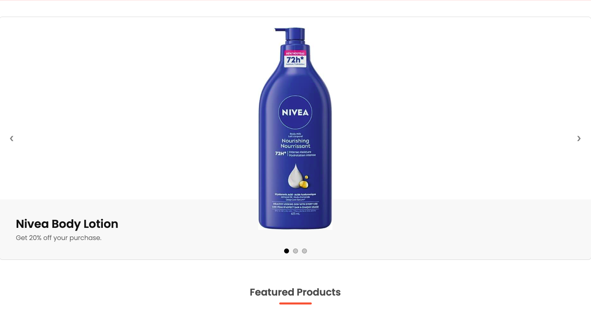
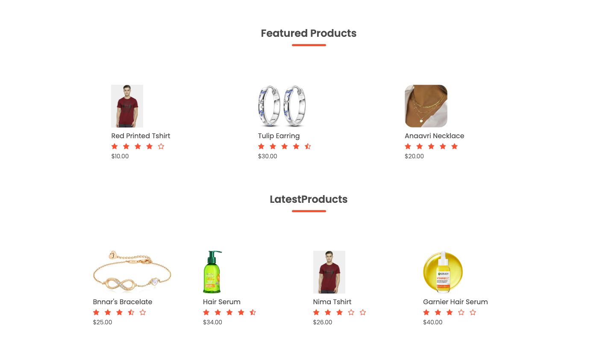
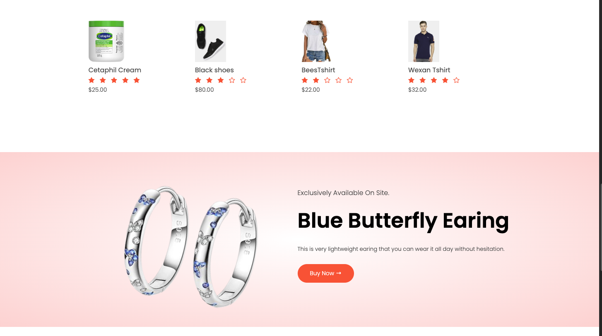
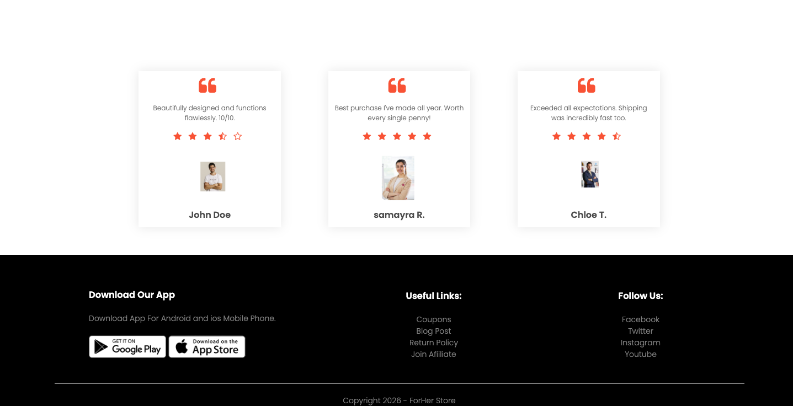

### Product Pages

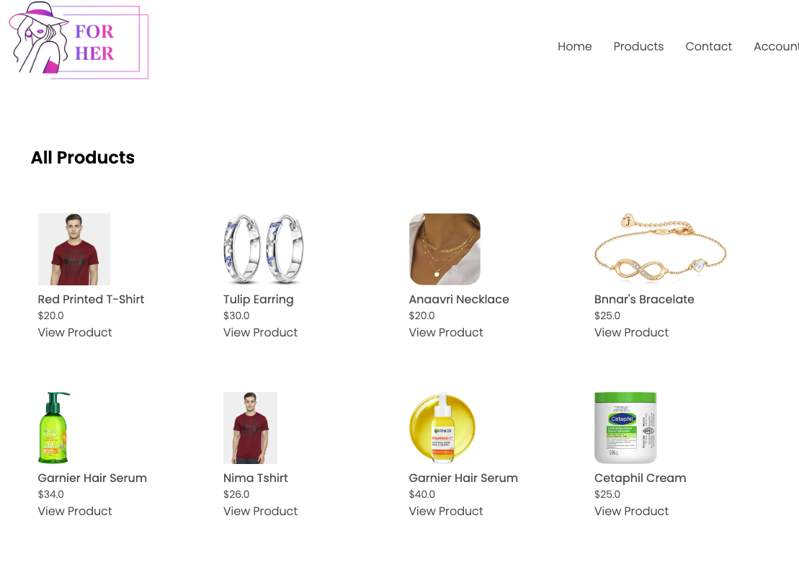
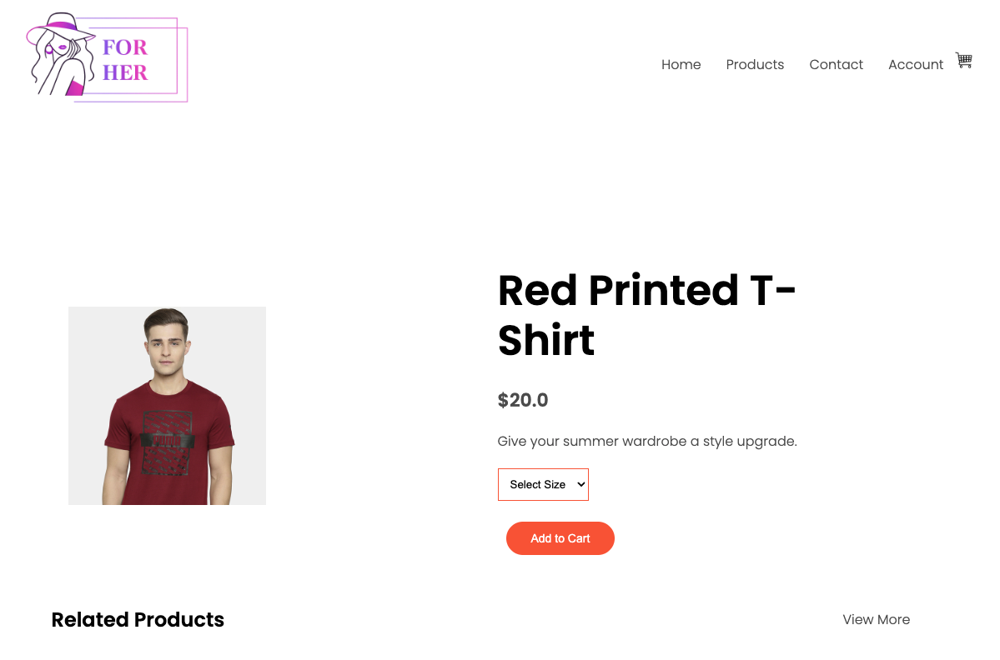
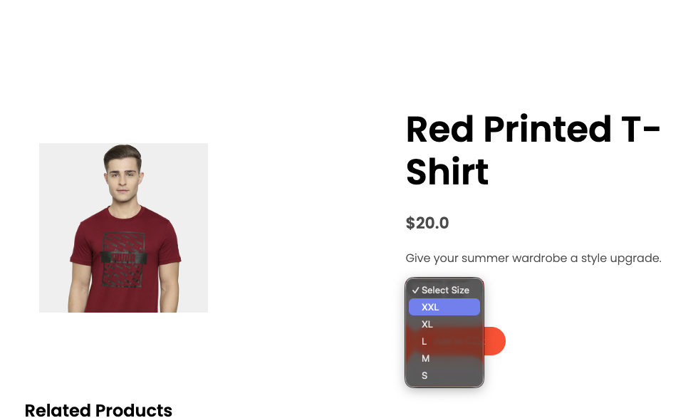
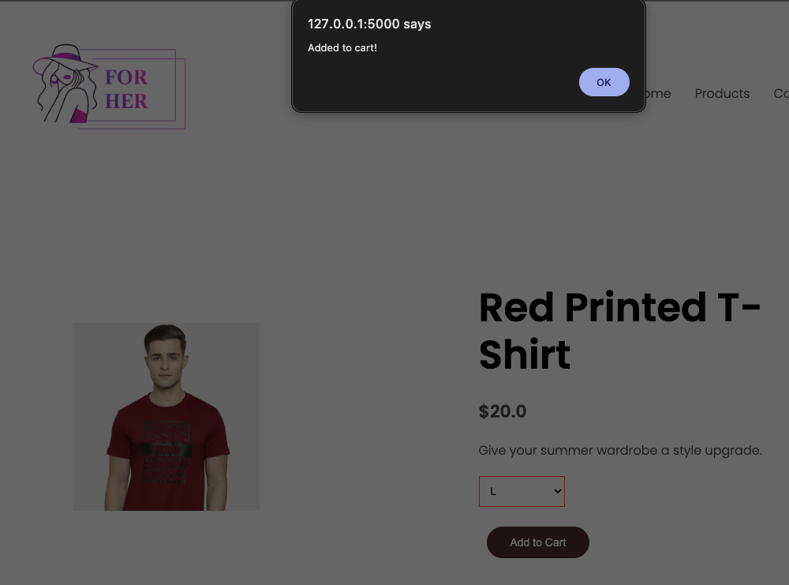


### Checkout

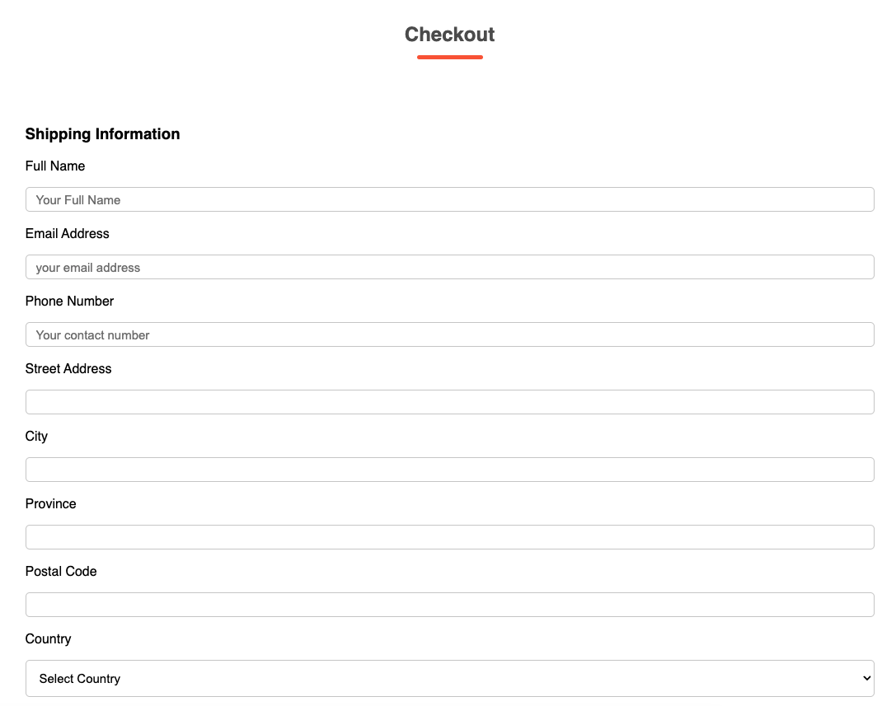

### Account page

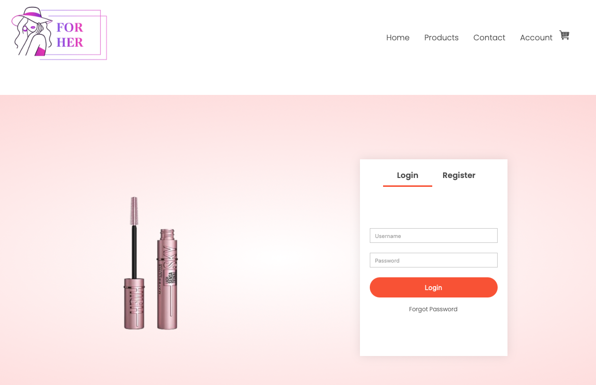

### Admin Dashboard and login

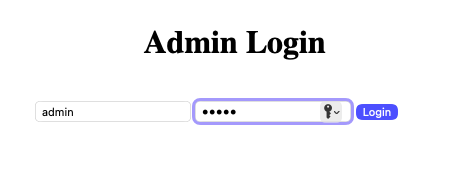
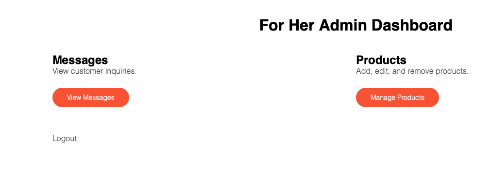
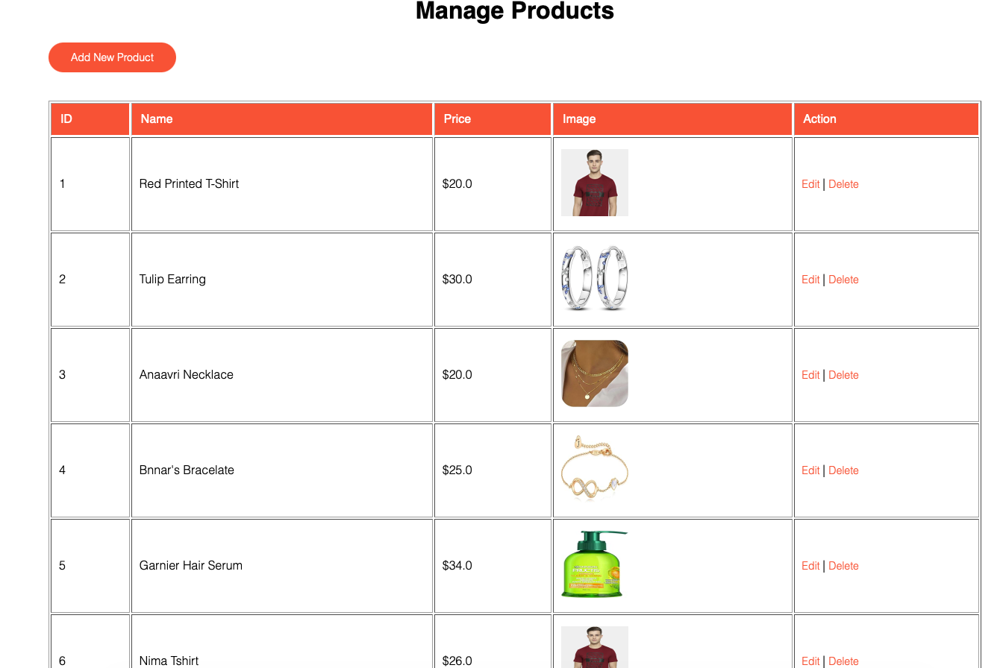
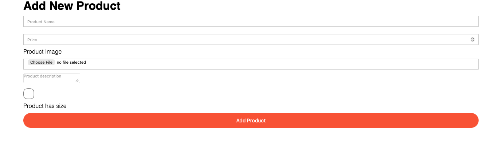

### Payment Page

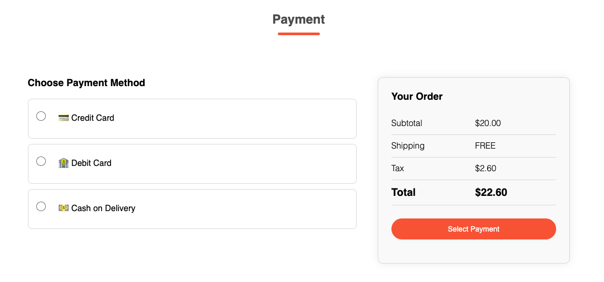
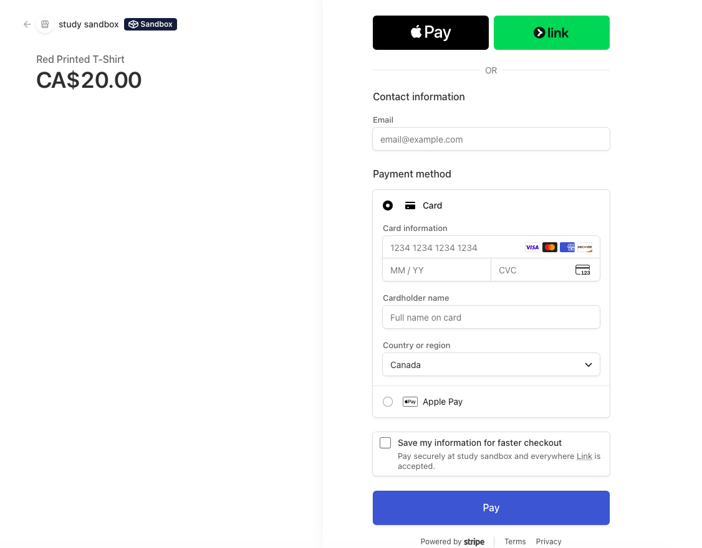

### Successful Page

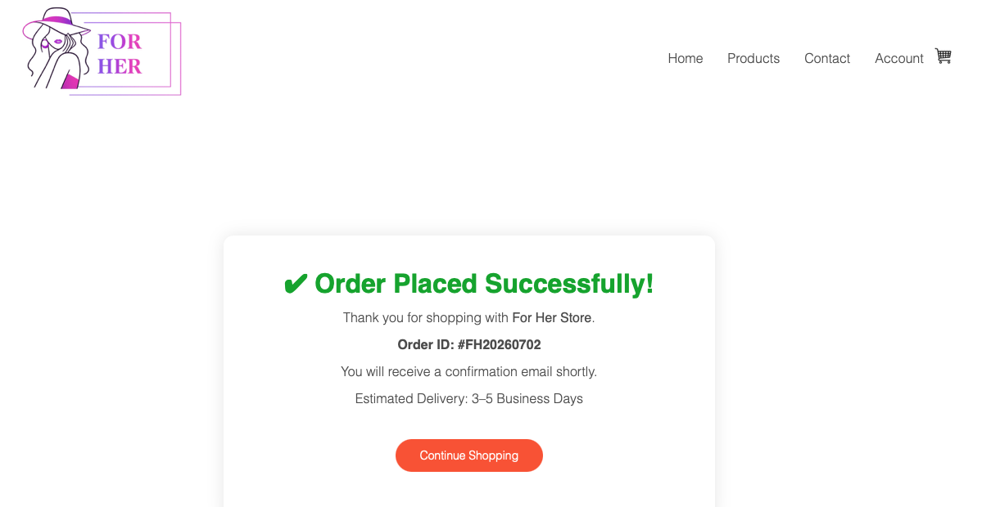


## Author

**Bhoomi Panchal**


